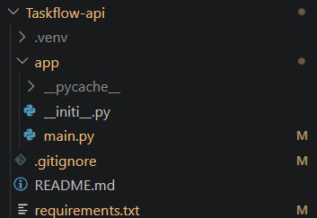
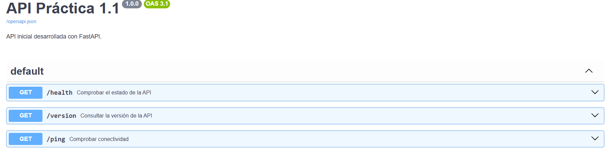
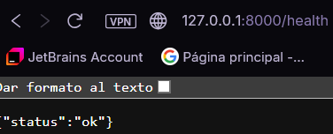
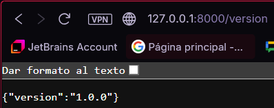
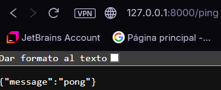
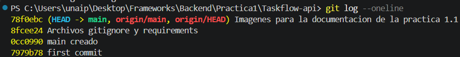

# Práctica 1.1 — Primeros endpoints y estructura inicial del proyecto

**Objetivo:** tener un servidor FastAPI corriendo con documentación automática.

---

## 1. Estructura del proyecto

```
Practica1/
├── evidencias/          # Capturas de pantalla de la práctica
└── Taskflow-api/
    ├── app/
    │   ├── __init__.py
    │   └── main.py
    ├── .gitignore
    └── requirements.txt
```

- `app/` contiene el código de la API. `__init__.py` lo convierte en paquete de Python.
- `main.py` es el punto de entrada: aquí se crea la aplicación FastAPI y se definen los endpoints.
- `requirements.txt` lista las dependencias del proyecto.
- `.gitignore` evita subir al repositorio el entorno virtual (`.venv/`) y archivos temporales.



---

## 2. Entorno virtual e instalación de dependencias

Se crea un entorno virtual para aislar las dependencias del proyecto, se activa y se instalan FastAPI y Uvicorn:

```powershell
python -m venv .venv
.venv\Scripts\activate
pip install fastapi uvicorn
pip freeze > requirements.txt
```


---

## 3. Endpoints implementados

Todos están definidos en `app/main.py`:

| Método | Ruta       | Descripción                         | Respuesta            |
|--------|------------|-------------------------------------|----------------------|
| GET    | `/health`  | Comprueba que el servidor está vivo | `{"status": "ok"}`   |
| GET    | `/version` | Devuelve la versión de la API       | Ver captura          |
| GET    | `/ping`    | Prueba de conectividad              | Ver captura          |

---

## 4. Arranque del servidor

Desde la carpeta `Taskflow-api`, con el entorno virtual activado:

```powershell
uvicorn app.main:app --reload
```

- `app.main` es el módulo (`app/main.py`).
- `app` es la instancia de FastAPI dentro de ese módulo.
- `--reload` reinicia el servidor automáticamente al guardar cambios.

El servidor arranca sin errores y queda disponible en `http://127.0.0.1:8000`.


---

## 5. Documentación automática (Swagger)

FastAPI genera la documentación de forma automática en `http://127.0.0.1:8000/docs`, donde se pueden ver y probar todos los endpoints.



---

## 6. Comprobación de los endpoints

Se verifica que cada endpoint responde correctamente.

**`/health`**



**`/version`**



**`/ping`**



---

## 7. Control de versiones con Git

El proyecto está en un repositorio Git con commits que corresponden a cada paso de la práctica.

```powershell
git log --oneline
```



---

## 8. Conclusión

Se ha creado un proyecto FastAPI con una estructura clara, un entorno virtual con dependencias instaladas, tres endpoints funcionales y documentación automática en `/docs`, todo versionado con Git.