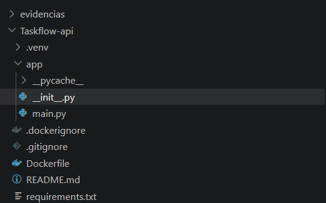
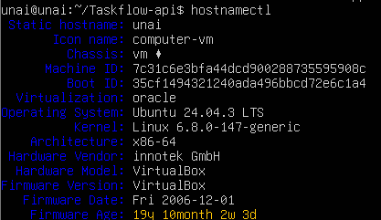
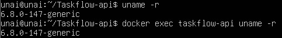
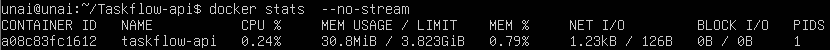

# Arquitecturas: instalación directa vs. contenedor

**Práctica 1.4 — Docker y primer contenedor** · Proyecto: TaskFlow API (FastAPI)

---

## 1. Contenedor vs. máquina virtual

- **Máquina virtual (VM):** simula un ordenador completo. Cada VM tiene su propio sistema operativo y su propio kernel.
- **Contenedor:** no tiene sistema operativo propio. Usa el kernel del equipo donde corre y solo aísla la aplicación y sus dependencias.

| | Máquina virtual | Contenedor |
|---|---|---|
| Aislamiento | Fuerte (kernel propio) | Medio (kernel compartido) |
| Peso | GB | MB |
| Arranque | Minutos | Segundos |
| Recursos | Muchos | Pocos |

---

## 2. Instalación directa vs. contenedor

| | Instalación directa | Contenedor |
|---|---|---|
| Instalar | Python, entorno y paquetes a mano en cada servidor | Un solo comando: `docker run` |
| Portabilidad | Depende del sistema | Igual en cualquier sitio |
| Dependencias | Pueden chocar con otros proyectos | Aisladas dentro de la imagen |
| Reproducible | Poco ("en mi PC funciona") | Mucho (lo define el `Dockerfile`) |
| Borrar | Quedan restos | `docker rm` y desaparece |

**Ventaja de la instalación directa:** es sencilla y cómoda para programar y probar rápido.
**Inconveniente:** cada servidor nuevo hay que configurarlo a mano y puede salir distinto.

**Ventaja del contenedor:** funciona igual en todas partes y se despliega rápido.
**Inconveniente:** hay que aprender Docker y el aislamiento es menor que en una VM.

---

## 3. Cuándo usar cada opción

- **Instalación directa:** para desarrollar y probar en local.
- **Contenedor:** para desplegar en un servidor o en la nube, y cuando quiero que todo el mundo ejecute lo mismo.
- **Máquina virtual:** cuando necesito un sistema operativo completo o un aislamiento muy fuerte.

---

## 4. Caso TaskFlow

El backend de TaskFlow es una API pequeña en FastAPI que no guarda datos en el propio proceso. Por eso encaja bien en un contenedor:

- Es ligera: no necesita un sistema operativo completo.
- Es fácil de copiar: se pueden arrancar varias iguales si hace falta.
- Es reproducible: las versiones de `requirements.txt` están fijadas.

Una **máquina virtual** para la API sería demasiado pesada. Un servidor web con necesidades propias de sistema operativo sí encajaría mejor en una VM.

---

## 5. Relación con la nube

La imagen que hemos construido (`taskflow-backend:1.0`) es lo que se despliega en la nube:

1. Se sube a un registro de imágenes (por ejemplo, Docker Hub).
2. Un servicio de contenedores de la nube la descarga y la ejecuta.

Como la imagen lleva todo dentro, funciona en la nube igual que en nuestro Ubuntu.

---

## 6. Ejemplo práctico

Para ejecutar TaskFlow en un servidor nuevo:

**Instalación directa**

```bash
sudo apt install python3 python3-venv python3-pip
python3 -m venv .venv
source .venv/bin/activate
pip install -r requirements.txt
uvicorn app.main:app --host 0.0.0.0 --port 8000
```

**Contenedor**

```bash
docker run -d --name taskflow-api -p 8000:8000 taskflow-backend:1.0
```

### Diagrama comparativo

```
   MÁQUINAS VIRTUALES                  CONTENEDORES

┌─────────┐ ┌─────────┐          ┌─────────┐ ┌─────────┐
│  App A  │ │  App B  │          │  App A  │ │  App B  │
│ SO + K. │ │ SO + K. │          └─────────┘ └─────────┘
└─────────┘ └─────────┘          ┌─────────────────────┐
┌─────────────────────┐          │    Docker Engine    │
│     Hipervisor      │          └─────────────────────┘
└─────────────────────┘          ┌─────────────────────┐
┌─────────────────────┐          │ SO del host (kernel)│
│    SO del host      │          └─────────────────────┘
└─────────────────────┘          ┌─────────────────────┐
┌─────────────────────┐          │      Hardware       │
│      Hardware       │          └─────────────────────┘
└─────────────────────┘
```

---

## 7. Pruebas en nuestro entorno

### 7.1 Estructura del proyecto hasta ahora



### 7.2 Nuestro servidor Ubuntu es una VM

Comando: `hostnamectl`



El contenedor corre **dentro** de esta VM.

### 7.3 El contenedor usa el mismo kernel que el host

Comandos: `uname -r` y `docker exec taskflow-api uname -r`



Los dos devuelven la misma versión: el contenedor no tiene kernel propio.

### 7.4 La imagen pesa poco

Comando: `docker images`


### 7.5 Consume pocos recursos

Comando: `docker stats --no-stream`



### 7.6 El contenedor funcionando


---

## Conclusión

La instalación directa sirve para desarrollar, pero para desplegar TaskFlow el contenedor es mejor: es ligero, se despliega con un comando y funciona igual en cualquier sitio, incluida la nube. La máquina virtual se reserva para cuando hace falta un sistema operativo completo o más aislamiento.