# Documento de pruebas: Práctica 1.4 — Docker y primer contenedor

**Proyecto:** TaskFlow API (FastAPI)
**Entorno:** Ubuntu Server 24.04 (máquina virtual) con Docker Engine. El código se desarrolla en Windows y se copia a Ubuntu por SSH (`scp`).

## Organización de la entrega

La carpeta de esta práctica (`Practica1.4`) está dentro de la carpeta principal del proyecto (`Practica1`), de modo que se ve la estructura real completa:

```
Practica1/
├── Taskflow-api/
│   ├── app/                  ← código de la API (práctica 1.1)
│   ├── requirements.txt
│   ├── Dockerfile            ← práctica 1.4
│   └── .dockerignore         ← práctica 1.4
├── Practica1.1.md
└── Practica1.4/
    ├── docs/
    │   ├── arquitectura.md
    │   └── pruebas.md
    └── evidencias/
```

El `Dockerfile` y el `.dockerignore` están en `Practica1/Taskflow-api/`, junto al código y a `requirements.txt`, que es lo que necesitan para construir la imagen. La imagen se construye desde esa carpeta:

```bash
cd Practica1/Taskflow-api
docker build -t taskflow-backend:1.0 .
```

> Las rutas de las imágenes de este documento asumen que este fichero está en `Practica1.4/docs/` y que la carpeta `evidencias` está en `Practica1.4/evidencias/`.

---

## 1. Sentencia de arranque del contenedor

```bash
docker build -t taskflow-backend:1.0 .
docker run -d --name taskflow-api -p 8000:8000 taskflow-backend:1.0
```

| Parte | Significado |
|---|---|
| `-d` | Ejecuta el contenedor en segundo plano |
| `--name taskflow-api` | Nombre del contenedor |
| `-p 8000:8000` | Publica el puerto 8000 del host en el 8000 del contenedor |
| `taskflow-backend:1.0` | Imagen y etiqueta usadas |

---

## 2. Instalación de Docker

Instalación desde el repositorio oficial de Docker en Ubuntu 24.04:

```bash
sudo apt update
sudo apt install -y ca-certificates curl gnupg
sudo install -m 0755 -d /etc/apt/keyrings
curl -fsSL https://download.docker.com/linux/ubuntu/gpg | sudo gpg --dearmor -o /etc/apt/keyrings/docker.gpg
sudo chmod a+r /etc/apt/keyrings/docker.gpg
echo "deb [arch=$(dpkg --print-architecture) signed-by=/etc/apt/keyrings/docker.gpg] https://download.docker.com/linux/ubuntu $(. /etc/os-release && echo $VERSION_CODENAME) stable" | sudo tee /etc/apt/sources.list.d/docker.list > /dev/null
sudo apt update
sudo apt install -y docker-ce docker-ce-cli containerd.io docker-buildx-plugin docker-compose-plugin
```

### Problemas encontrados y cómo se resolvieron

| Problema | Causa | Solución |
|---|---|---|
| `E: Se ha suministrado el fichero no admitido /etc/apt/keyrings/` | Se escribió `sudo apt install -m ...` en lugar de `sudo install -m ...` | Usar `sudo install -m 0755 -d /etc/apt/keyrings` |
| `apt update` daba error con `file:/cdrom noble Release` | Resto del instalador de Ubuntu en `/etc/apt/sources.list` | Comentar la línea: `sudo sed -i '1s/^/# /' /etc/apt/sources.list` |
| `docker-ce no tiene un candidato para la instalación` | Faltaba crear `/etc/apt/sources.list.d/docker.list` | Crear el repositorio con el comando `echo ... \| sudo tee` y repetir `apt update` |
| `failed to connect to the docker API at unix:///var/run/docker.sock` | El servicio no estaba arrancado | `sudo systemctl start docker` |

### Versión instalada

```bash
docker --version
```

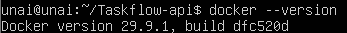

### Servicio activo y habilitado

```bash
sudo systemctl enable docker
sudo systemctl status docker
```

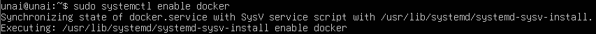

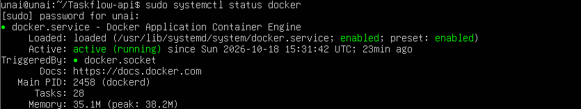

### Prueba hello-world

```bash
docker run hello-world
```

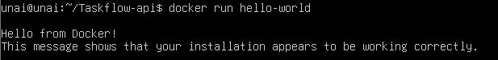

### Post-instalación

Arranque automático del servicio y uso de Docker sin `sudo`:

```bash
sudo systemctl enable docker
sudo systemctl start docker
sudo usermod -aG docker $USER
newgrp docker
groups
```

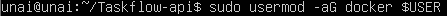

---

## 3. Construcción de la imagen

Ficheros usados, en `~/Taskflow-api` dentro de Ubuntu:

**Dockerfile**

```dockerfile
FROM python:3.12-slim

WORKDIR /code

COPY requirements.txt .
RUN pip install --no-cache-dir -r requirements.txt

COPY app ./app

EXPOSE 8000

CMD ["uvicorn", "app.main:app", "--host", "0.0.0.0", "--port", "8000"]
```

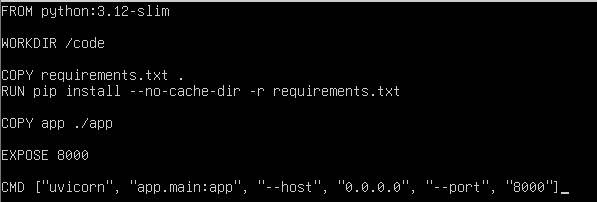

**.dockerignore**

```
.venv
__pycache__
*.pyc
.git
```

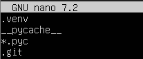

**Traída del `Dockerfile` y `.dockerignore` desde Ubuntu a Windows (por SSH):**

Estos dos ficheros se crearon y probaron en el servidor Ubuntu, que es donde corre Docker. Para incluirlos en el proyecto de Windows (la carpeta que se entrega) se copiaron desde Ubuntu mediante SSH con `scp`, ejecutando en Windows:

```powershell
cd C:\ruta\a\Practica1\Taskflow-api
scp unai@192.168.1.243:~/Taskflow-api/Dockerfile .
scp unai@192.168.1.243:~/Taskflow-api/.dockerignore .
```

El punto final indica que los ficheros se guardan en la carpeta actual de Windows. De este modo, el `Dockerfile` y el `.dockerignore` entregados son exactamente los mismos que se usaron para construir la imagen en Ubuntu.

**Copia del código a Ubuntu (desde Windows):**

El proceso inverso, de Windows a Ubuntu, se hizo para el código de la API, ya que Docker está instalado en Ubuntu y necesita el código para construir la imagen:

```powershell
scp -r app requirements.txt unai@192.168.1.243:~/Taskflow-api/
```

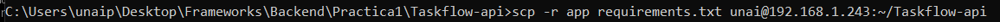

**Construcción y comprobación:**

```bash
docker build -t taskflow-backend:1.0 .
docker images
```

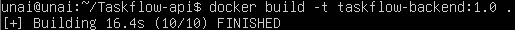

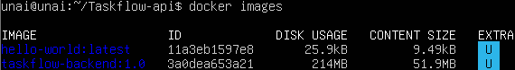

### Problemas encontrados

| Problema | Causa | Solución |
|---|---|---|
| `failed to read dockerfile: open Dockerfile: no such file or directory` | `Dockerfile` y `.dockerignore` estaban fuera de `~/Taskflow-api` | Moverlos: `mv ~/Dockerfile ~/.dockerignore ~/Taskflow-api/` |
| `COPY app ./app: not found` con contexto de 2 B | El `docker build` se ejecutó en una carpeta sin el código | Ejecutar el build dentro de `~/Taskflow-api` |

---

## 4. Contenedor en funcionamiento

```bash
docker run -d --name taskflow-api -p 8000:8000 taskflow-backend:1.0
docker ps
docker logs taskflow-api
```

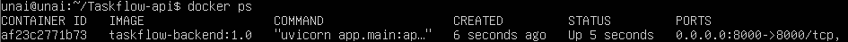

### Pruebas de los endpoints

Desde Ubuntu:

```bash
curl http://localhost:8000/health    # {"status":"ok"}
curl http://localhost:8000/ping      # {"message":"pong"}
curl http://localhost:8000/version   # {"version":"1.0.0"}
```

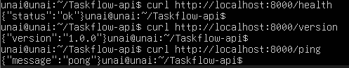

### Acceso a /docs (Swagger) desde Windows

URL: `http://192.168.1.243:8000/docs`

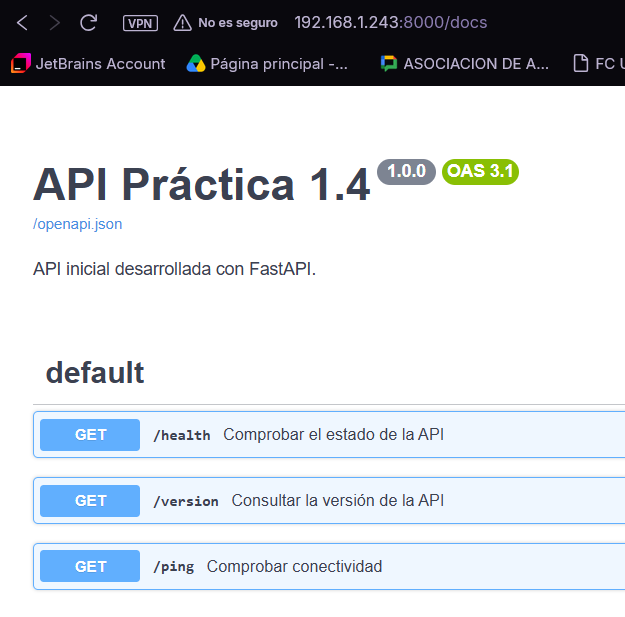
Los logs del contenedor confirman las peticiones recibidas desde Windows (`GET /docs` y `GET /openapi.json` con respuesta `200 OK`).

### Incidencia: el título no cambiaba

Al modificar `app/main.py` en Ubuntu, el contenedor en marcha seguía mostrando el título anterior. El `COPY app ./app` del `Dockerfile` guarda una **copia** del código dentro de la imagen, por lo que editar el fichero después no afecta al contenedor. Solución: recrear imagen y contenedor.

```bash
docker rm -f taskflow-api
docker build -t taskflow-backend:1.0 .
docker run -d --name taskflow-api -p 8000:8000 taskflow-backend:1.0
```

---

## 5. Ciclo de vida del contenedor

| Acción | Comando |
|---|---|
| Parar | `docker stop taskflow-api` |
| Arrancar | `docker start taskflow-api` |
| Reiniciar | `docker restart taskflow-api` |
| Eliminar | `docker rm -f taskflow-api` |

**Parar:**

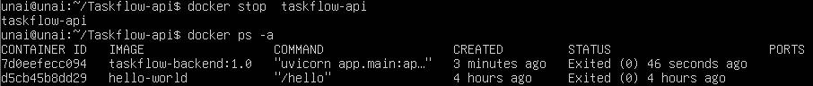

**Arrancar de nuevo:**

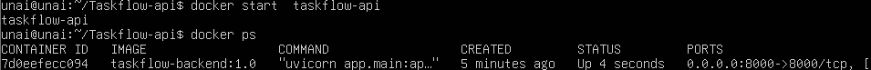

**Reiniciar:**

```bash
docker restart taskflow-api
docker ps
```

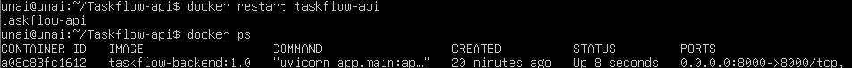

**Eliminar:**

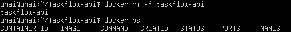

---

## 6. Resumen de criterios de aceptación

| Criterio | Cumplido | Evidencia |
|---|---|---|
| Docker instalado y servicio `docker` activo | Sí | Sección 2 |
| Contenedor arrancando y respondiendo correctamente | Sí | Sección 4 |
| Análisis comparativo en `docs/arquitectura.md` | Sí | `docs/arquitectura.md` |